# PSllama

Local AI inference on a jailbroken PlayStation 5, through Vulkan.

PSllama is a homebrew PS5 application that runs language, vision, speech, image, video and robot-policy models on the console's GPU and serves them over an OpenAI-style HTTP API. It is built from [llama.cpp](https://github.com/ggml-org/llama.cpp), [stable-diffusion.cpp](https://github.com/leejet/stable-diffusion.cpp) and [whisper.cpp](https://github.com/ggml-org/whisper.cpp), all sharing one ggml Vulkan backend on the Mesa RADV driver from the [PS5_Vulkan](https://github.com/mihawk-99/PS5_Vulkan) project.

> **Status: experimental.** Tested on one console (CFI-1208B, firmware 13.60). It needs a jailbroken PS5 and is not affiliated with or endorsed by Sony. Every number below was measured on that console.

**Project page with playable video and audio: [mansanitizer.github.io/psllama](https://mansanitizer.github.io/psllama/)**. The dated working log is [`docs/FINDINGS.md`](docs/FINDINGS.md).

<p>
  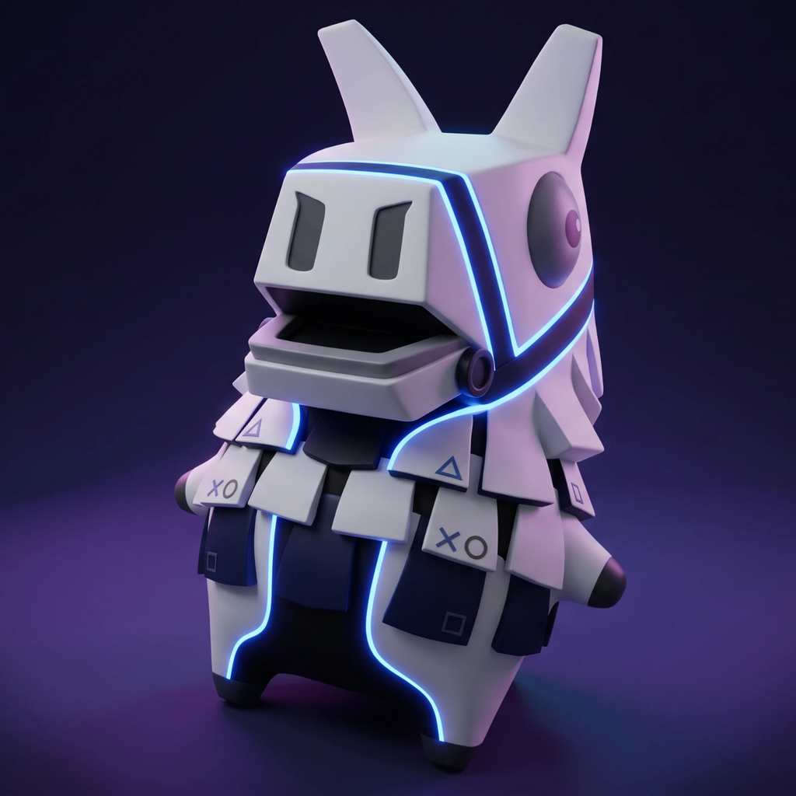
</p>

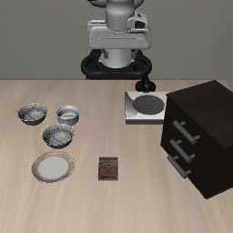

*OpenVLA running on the console, driving a simulated arm: "pick up the black bowl between the plate and the ramekin and place it on the plate".*

## What works

| Capability | Engine | Largest or typical model tested | Headline measurement |
|---|---|---|---|
| Text generation | llama.cpp | Qwen3-30B-A3B (IQ2_XXS, 10.4 GB) | 35 to 96 tok/s depending on the prompt |
| Image understanding | llama.cpp + mtmd | Gemma 3 12B, Qwen2.5-VL 7B | About 2.7 s per image before the answer starts |
| State-space models | llama.cpp | Falcon-H1 34B, Mamba-Codestral 7B, Mamba 1.4B | 17 to 480 tok/s |
| Speech to text | whisper.cpp | Whisper large-v3-turbo | 8 s of audio in 0.79 s |
| Text to speech | llama.cpp + mtmd | Qwen3-TTS 1.7B, with voice cloning | About 2× real time |
| Voice agent | all three | Whisper + Qwen3-4B + Qwen3-TTS | 2.3 to 2.7 s to first audio when warm |
| Image generation and editing | stable-diffusion.cpp | FLUX.2-klein 4B, Z-Image-Turbo | 17.6 s at 768×768 (FLUX.2-klein, 4 steps) |
| Video generation | stable-diffusion.cpp | HunyuanVideo 1.5 I2V, Wan 2.1 1.3B | 17 frames at 416×224 in 107 s |
| Robot policy | llama.cpp + a vision encoder written for this project | OpenVLA 7B (LIBERO-Spatial) | 23 of 30 simulated tasks, 0.94 s per action |

## Repository layout

| Path | Contents |
|---|---|
| `app/` | The PS5 application: HTTP server, model services, build script, model configuration examples |
| `patches/llama.cpp/` | Changes to llama.cpp at `552f18f91`, including the Mamba-1 GPU scan shader |
| `tools/` | Development tools for a Linux build host: log recorder, deploy and benchmark driver, upload scripts |
| `web/` | A browser interface (chat, voice, image, video, audio) and the small proxy that serves it |
| `examples/api/` | Short scripts calling each endpoint |
| `examples/openvla/` | LIBERO evaluation client and the reference check for the image encoder |
| `examples/vlm-arm/` | A simulated arm driven by a general vision model choosing high-level steps |
| `docs/` | The illustrated page, media, and the working log |

## Requirements

- **Console:** a jailbroken PS5 with a payload loader. Tested on CFI-1208B, firmware 13.60.
- **Payloads on the console:** an ELF loader (`elfldr`), an FTP server (`ftpsrv`) and `ShadowMount+` to register and mount the app folder. `shsrv` (shell) and `klogsrv` (kernel log) are needed for development.
- **Build host:** Linux x86-64 with the PS5_Vulkan toolchain and its RADV build, `cmake`, `clang` and `glslc`.
- **Storage:** the application is about 115 MB. Models are 0.1 to 14 GB each.
- **Network:** the server only answers clients on a Tailscale network (100.64.0.0/10) and requires an API key.

The console has 16 GB shared between CPU and GPU. The app gets a 12 GiB Vulkan heap plus about 2.3 GB on the CPU side, so a model and its working memory must fit in roughly 12 GiB.

## How to install

There is no prebuilt package. These are the steps used during development.

### 1. Prepare the build host

1. Set up [PS5_Vulkan](https://github.com/mihawk-99/PS5_Vulkan) and build its RADV driver (`tools/build-radv.sh`). The driver ships as source.
2. Check out the three engines at the revisions PSllama was developed against:

   | Project | Revision |
   |---|---|
   | llama.cpp | `552f18f91` |
   | stable-diffusion.cpp | `f89d9b1` |
   | whisper.cpp | `d1be6fd` |

3. Apply the llama.cpp changes:

   ```bash
   cd /path/to/llama.cpp
   git apply /path/to/psllama/patches/llama.cpp/psllama-vs-552f18f91.patch
   cp /path/to/psllama/patches/llama.cpp/ssm_scan_mamba1.comp ggml/src/ggml-vulkan/vulkan-shaders/
   ```

   The patch covers the sampler fix, the memory-budget override, tuning switches and the Mamba-1 GPU scan. `apply_mamba1_scan.py` applies only the Mamba-1 part to an otherwise unpatched tree.

### 2. Build

1. Cross-build llama.cpp with the Vulkan backend for the PS5, with `-DGGML_MAX_NAME=160` and the multimodal library enabled. stable-diffusion.cpp needs the longer tensor names, and all three engines must share this one ggml build.
2. Build stable-diffusion.cpp against that same ggml using `app/sd/CMakeLists.txt`.
3. Build the application. The API key is given here and compiled in:

   ```bash
   cd app
   PSLLAMA_API_KEY="$(openssl rand -hex 32)" \
   PS5_VULKAN_ROOT=/path/to/ps5-vulkan \
   LLAMA_SOURCE=/path/to/llama.cpp \
   LLAMA_BUILD=/path/to/llama.cpp/build-ps5 \
   SD_SOURCE=/path/to/stable-diffusion.cpp \
   SD_BUILD=/path/to/sd-build-ps5 \
   WHISPER_SOURCE=/path/to/whisper.cpp \
   OUT=$PWD/out/my-build \
   bash ./build-gguf-vk-title.sh
   ```

   Keep the key; every client needs it. The result is `out/my-build/eboot.bin` plus an `sce_module` folder.

### 3. Install on the console

1. Create the app folder, for example `/data/homebrew/PPSA99005/`, and upload `eboot.bin` and `sce_module/` to it over FTP.
2. Add `sce_sys/param.json` (title id and name) and `sce_sys/icon0.png` (512×512; one is in `app/sce_sys/`). The app will not register without an icon.
3. Reboot and re-jailbreak. ShadowMount+ registers app folders when it starts; registering a new title later in the same session failed for us.
4. Create `vk-env.conf` in the app folder:

   ```
   GGML_VK_IGNORE_MEMORY_BUDGET=1
   GGML_VK_SUBALLOCATION_BLOCK_SIZE=268435456
   ```

   The first works around memory counters that only ever grow on this driver. The second (256 MB blocks) avoids allocation failures after switching models.

### 4. Add models

Upload model files into the app folder over FTP. The console sees that folder as `/app0`.

| Kind | Layout in the app folder |
|---|---|
| Language model | `<name>.gguf` |
| Vision projector for a language model | `<name>.mmproj.gguf`, next to `<name>.gguf` |
| Image or video model | A folder with the model files and an `sd-model.conf` naming them (examples in `app/sd/models/`) |
| Speech to text | `whisper/ggml-large-v3-turbo-q5_0.bin` |
| Text to speech | `qwen3-tts-1.7b/` with the model and its projector |
| OpenVLA | `<name>.gguf` (language model) and `<name>/dinov2.gguf`, `siglip.gguf`, `proj.gguf` |

### 5. Start and check

Launch the app from the home screen, then, from a machine on the same Tailscale network:

```bash
curl -H "Authorization: Bearer $PSLLAMA_API_KEY" http://$PS5_HOST:8081/health
```

The first launch loads the default model, which takes about 100 seconds.

### The web interface (optional)

```bash
cd web
PS5_HOST=<console address> PSLLAMA_API_KEY=<key> python3 server.py --port 8080
```

Then open `http://localhost:8080`. The proxy listens on all network interfaces without a password and includes tools that run Python and fetch web pages on the machine it runs on, so use it only on a network you trust. The microphone needs HTTPS: put a certificate and key in `web/certs/` as `server.crt` and `server.key` (or set `PSLLAMA_TLS_NAME`) and the proxy also listens on port 8443.

## Usage

All endpoints need the `Authorization: Bearer` header. Chat follows the OpenAI format.

| Endpoint | Purpose |
|---|---|
| `GET /health` | What is loaded, and with which settings |
| `GET /v1/models` | Language models in the app folder |
| `POST /v1/models/load` | Load a language model; with `"stream": true` it reports progress |
| `POST /v1/chat/completions` | Chat, streaming or not; accepts images as `image_url` parts when the model has a projector |
| `POST /v1/images/generations` | Text to image; `ref_images_b64` for editing, `init_image_b64` for image to image |
| `POST /v1/videos/generations` | Text or image to video; returns PNG frames |
| `POST /v1/audio/transcriptions` | Speech to text from a WAV file |
| `POST /v1/audio/speech` | Text to speech, optionally in a reference voice |
| `POST /v1/voice/chat` | One spoken turn: speech in, streamed text and speech out |
| `POST /v1/vla/act` | One OpenVLA control step: a 224×224 image and an instruction in, seven action values out |

```bash
curl http://$PS5_HOST:8081/v1/chat/completions \
  -H "Authorization: Bearer $PSLLAMA_API_KEY" -H "Content-Type: application/json" \
  -d '{"messages": [{"role": "user", "content": "Hello"}], "max_tokens": 64}'
```

Only one request runs at a time. Image and video models take the whole GPU, so the language model is unloaded for them and reloaded on the next chat request. Speech models and a language model under 5 GB stay loaded together.

## Results

Measured on a base PS5 (CFI-1208B). Language-model rates are greedy decoding at a 4,096-token context unless stated.

### Language models

| Model | File | Size | Generation | Notes |
|---|---|---:|---:|---|
| Qwen3-4B | Q4_K_M | 2.5 GB | about 70 tok/s | Used by the voice agent |
| Qwen2.5-VL 7B | Q4_K_M | 4.7 GB | 62 tok/s | Needs a q8_0 or f16 KV cache |
| Gemma 3 12B | Q4_K_M | 7.3 GB | 36 to 39 tok/s | Largest context that fit: 30,720 tokens |
| Gemma 3 27B | UD-IQ2_XXS | 7.9 GB | 20.8 tok/s | |
| Qwen3-30B-A3B (mixture of experts) | UD-IQ2_XXS | 10.4 GB | 35 to 96 tok/s | Varies with the prompt; largest context that fit: 28,672 tokens |

A working rule for Q4_K files on this GPU: time per token is about 3.3 ms plus the file size divided by 386 GB/s. The heavily compressed IQ2 formats run at roughly half that memory rate.

### State-space models

| Model | Type | Size | GPU, writing | CPU, writing |
|---|---|---:|---:|---:|
| Mamba 130M | Mamba-1 | 0.09 GB | 480 tok/s | 137 tok/s |
| Mamba 1.4B Instruct | Mamba-1 | 0.82 GB | 160 tok/s | 24 tok/s |
| mamba2-130m | Mamba-2 | 0.18 GB | 480 tok/s | 137 tok/s |
| Granite 4.0 H 350M | Mamba-2 hybrid | 0.22 GB | 180 to 214 tok/s | 39 to 44 tok/s |
| Falcon-H1 0.5B Instruct | Mamba-2 hybrid | 0.31 GB | 183 to 192 tok/s | 34 to 63 tok/s |
| Mamba-Codestral 7B | Mamba-2 | 4.15 GB | 54 to 56 tok/s | 5.4 tok/s |
| Falcon-H1 34B Instruct | Mamba-2 hybrid | 9.49 GB (IQ2_XXS) | 16 to 17 tok/s | 1.2 tok/s |

Mamba-2 models ran on the GPU without changes. Mamba-1 needed a new GPU shader; before it, Mamba 1.4B wrote 26 tok/s. Writing speed does not fall as the prompt grows, because these models keep a fixed-size state where a transformer keeps a cache that grows with every token.

### Robot policy: OpenVLA on LIBERO-Spatial

OpenVLA (LIBERO-Spatial fine-tune, Llama-2 7B at Q4_K_M) runs on the console; the LIBERO simulator runs on a separate Linux machine and sends one camera frame per control step.

| Measure | Result |
|---|---|
| Episodes completed | 23 of 30 (77%), 10 tasks × 3 tries |
| Published result for this checkpoint | 84.7% over 500 episodes at full precision |
| Time per control step on the console | 0.94 s (image encoder 0.16 s, prompt 0.68 s, action tokens 0.10 s) |
| Steps per successful episode | 112 on average, about 2 minutes |

With 30 episodes the uncertainty is roughly ±15 points, so this is consistent with the published figure but does not establish that 4-bit weights cost nothing.

### Images, video and speech

| Task | Model and settings | Time |
|---|---|---:|
| Image | SD-Turbo, 512×512, 1 step | 0.9 s |
| Image | FLUX.2-klein 4B, 768×768, 4 steps | 17.6 s |
| Image edit from a reference | FLUX.2-klein 4B, 512×512 | 13.8 s |
| Image | Z-Image-Turbo, 512 / 768 / 1024 square, 8 steps | 18 / 42 / 80 s |
| Video | Wan 2.1 T2V 1.3B, 9 frames, 416×240 | about 60 s |
| Video | HunyuanVideo 1.5 I2V, 17 frames, 416×224 | 107 s |
| Video | HunyuanVideo 1.5 I2V, 33 frames, 832×480 | 36 minutes |
| Speech to text | Whisper large-v3-turbo, 8 s of audio | 0.79 s |
| Text to speech | Qwen3-TTS 1.7B, 7 s of speech | 3.5 s |

## Media

Everything here was produced on the console. Video and audio play in the browser on the [project page](https://mansanitizer.github.io/psllama/#media); GitHub shows them as links.

### OpenVLA driving a simulated arm (LIBERO-Spatial)

The first try of each of the ten tasks. Each instruction ends "...and place it on the plate".

<table>
  <tr>
    <td align="center" valign="top" width="160"><br><sub>Task 0: bowl between the plate and the ramekin. Completed.</sub></td>
    <td align="center" valign="top" width="160">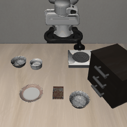<br><sub>Task 1: bowl next to the ramekin. Completed.</sub></td>
    <td align="center" valign="top" width="160">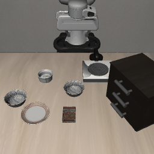<br><sub>Task 2: bowl from the table centre. <b>Failed</b> (ran to the step limit).</sub></td>
    <td align="center" valign="top" width="160">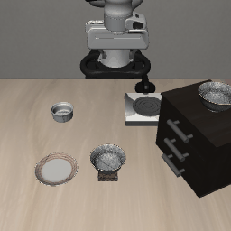<br><sub>Task 3: bowl on the cookie box. Completed.</sub></td>
    <td align="center" valign="top" width="160">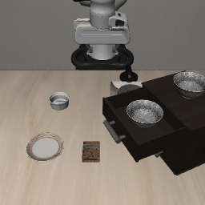<br><sub>Task 4: bowl in the top drawer of the cabinet. Completed.</sub></td>
  </tr>
  <tr>
    <td align="center" valign="top" width="160">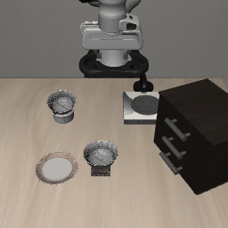<br><sub>Task 5: bowl on the ramekin. Completed.</sub></td>
    <td align="center" valign="top" width="160">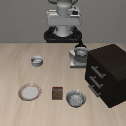<br><sub>Task 6: bowl next to the cookie box. Completed.</sub></td>
    <td align="center" valign="top" width="160">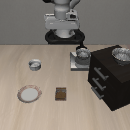<br><sub>Task 7: bowl on the stove. Completed.</sub></td>
    <td align="center" valign="top" width="160">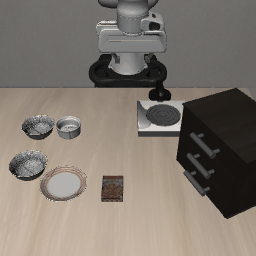<br><sub>Task 8: bowl next to the plate. Completed.</sub></td>
    <td align="center" valign="top" width="160">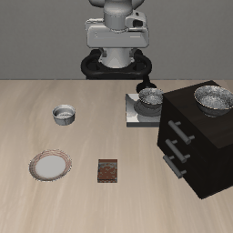<br><sub>Task 9: bowl on the wooden cabinet. Completed.</sub></td>
  </tr>
</table>

### Image generation

The same prompt on four models.

<table>
  <tr>
    <td align="center" valign="top" width="200">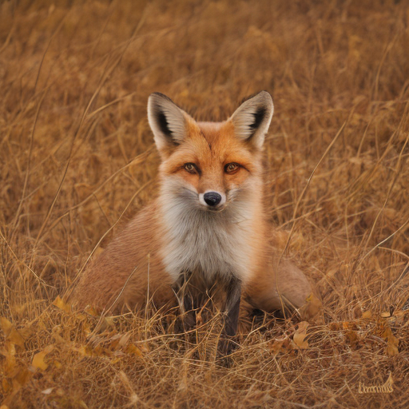<br><sub>SD-Turbo, 512×512, 1 step, 0.9 s</sub></td>
    <td align="center" valign="top" width="200"><br><sub>FLUX.2-klein 4B, 768×768, 4 steps, 17.6 s</sub></td>
    <td align="center" valign="top" width="200">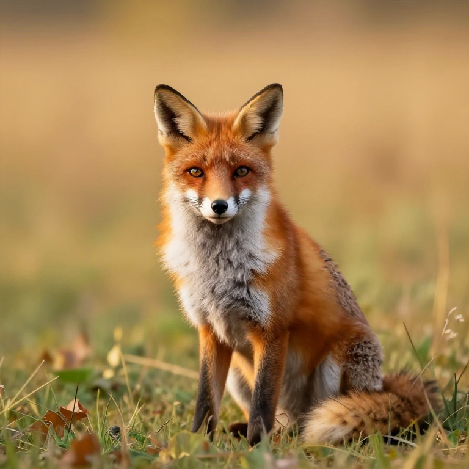<br><sub>Z-Image-Turbo, 768×768, 8 steps, 42 s</sub></td>
    <td align="center" valign="top" width="200"><br><sub>ERNIE-Image-Turbo, 768×768, 8 steps, 66 s</sub></td>
  </tr>
  <tr>
    <td align="center" valign="top" width="200">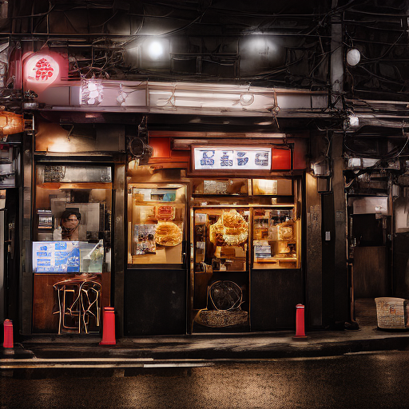<br><sub>SD-Turbo</sub></td>
    <td align="center" valign="top" width="200"><br><sub>FLUX.2-klein 4B</sub></td>
    <td align="center" valign="top" width="200">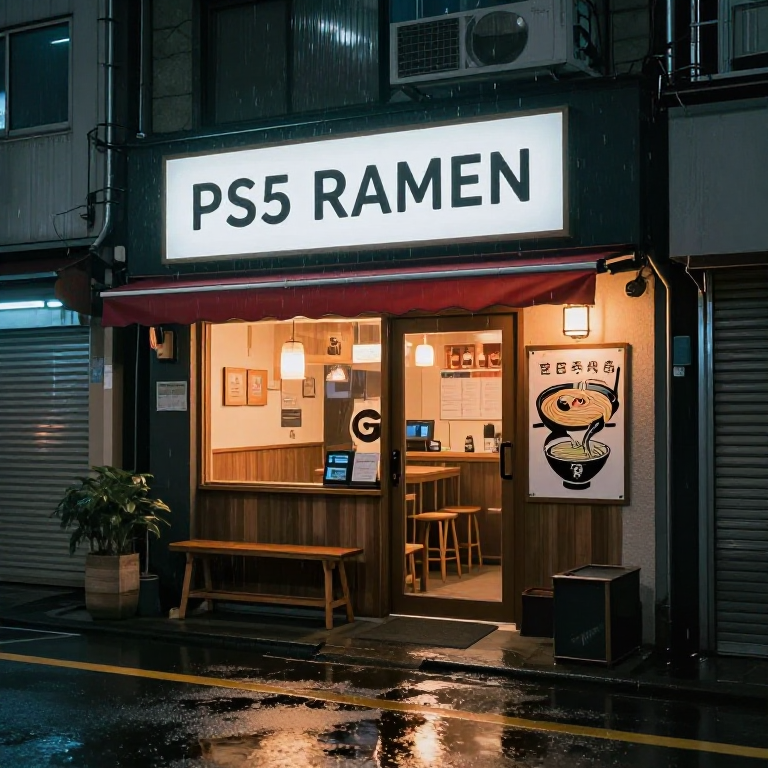<br><sub>Z-Image-Turbo</sub></td>
    <td align="center" valign="top" width="200">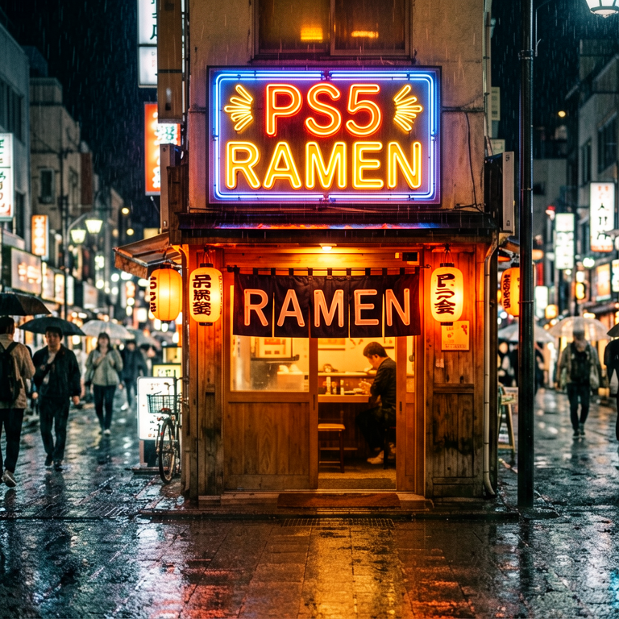<br><sub>ERNIE-Image-Turbo</sub></td>
  </tr>
  <tr>
    <td align="center" valign="top" width="200">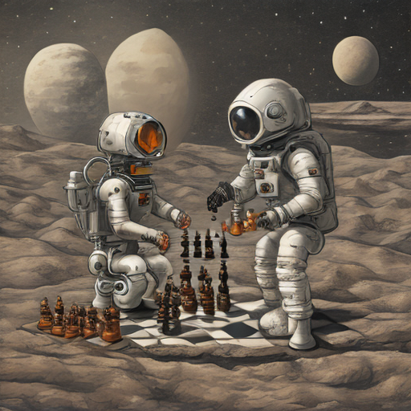<br><sub>SD-Turbo</sub></td>
    <td align="center" valign="top" width="200"><br><sub>FLUX.2-klein 4B</sub></td>
    <td align="center" valign="top" width="200"><br><sub>Z-Image-Turbo</sub></td>
    <td align="center" valign="top" width="200"><br><sub>ERNIE-Image-Turbo</sub></td>
  </tr>
</table>

All comparison images, including Z-Image-Turbo at Q4_K, are in [`docs/media/compare-20261010/`](docs/media/compare-20261010/) with their [timings](docs/media/compare-20261010/timings.json).

### Image editing (FLUX.2-klein)

<table>
  <tr>
    <td align="center" valign="top" width="260"><br><sub>Generated base image</sub></td>
    <td align="center" valign="top" width="260"><br><sub>Reference edit: “the same fox wearing a blue knitted scarf, in a neon-lit city street at night”, 13.8 s</sub></td>
    <td align="center" valign="top" width="260">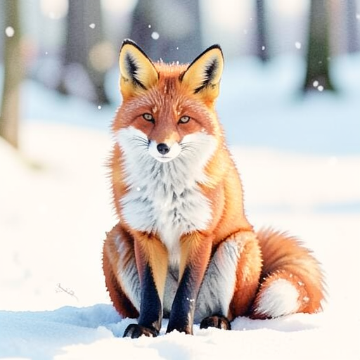<br><sub>Image to image at strength 0.6 with a “watercolor” prompt; it barely changes on a 4-step model</sub></td>
  </tr>
</table>

### Video

| Clip | Model and settings | Watch | File |
|---|---|---|---|
| Fox, text to video | Wan 2.1 T2V 1.3B, 9 frames, 416×240 | [play](https://mansanitizer.github.io/psllama/video/ps5-wan2.1-1.3b-fox-9frames.mp4) | [`mp4`](docs/video/ps5-wan2.1-1.3b-fox-9frames.mp4) |
| Fox, from a still image | HunyuanVideo 1.5 I2V, 17 frames, 416×224 | [play](https://mansanitizer.github.io/psllama/video/ps5-hunyuanvideo1.5-i2v-fox-17frames.mp4) | [`mp4`](docs/video/ps5-hunyuanvideo1.5-i2v-fox-17frames.mp4) |
| Fox, from a still image | Wan 2.2 TI2V 5B, 17 frames (poor at this small size) | [play](https://mansanitizer.github.io/psllama/video/ps5-wan2.2-5b-i2v-fox-17frames.mp4) | [`mp4`](docs/video/ps5-wan2.2-5b-i2v-fox-17frames.mp4) |
| Longer clip from the web interface | HunyuanVideo 1.5, 832×480 | [play](https://mansanitizer.github.io/psllama/video/ps5-clip.mp4) | [`mp4`](docs/video/ps5-clip.mp4) |

### Speech

| Sample | Listen | File |
|---|---|---|
| Voice agent reply, turn 1 (question: the capital of France) | [play](https://mansanitizer.github.io/psllama/media/voice-test/turn1-reply.wav) | [`wav`](docs/media/voice-test/turn1-reply.wav) |
| Voice agent reply, turn 2, using the conversation so far | [play](https://mansanitizer.github.io/psllama/media/voice-test/turn2-reply.wav) | [`wav`](docs/media/voice-test/turn2-reply.wav) |
| Qwen3-TTS, default voice | [play](https://mansanitizer.github.io/psllama/audio/ps5-qwen3-tts-default-voice.wav) | [`wav`](docs/audio/ps5-qwen3-tts-default-voice.wav) |
| Qwen3-TTS copying a reference voice | [play](https://mansanitizer.github.io/psllama/audio/ps5-qwen3-tts-cloned-voice.wav) | [`wav`](docs/audio/ps5-qwen3-tts-cloned-voice.wav) |

### A general vision model choosing the arm's steps

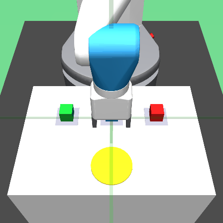

*Gemma 3 12B on the console looks at each frame and picks a command; the arm motion for each command is scripted. See [`examples/vlm-arm/`](examples/vlm-arm/).*

## Findings

A selection; the full log is in [`docs/FINDINGS.md`](docs/FINDINGS.md).

**Memory**

1. The driver's memory-budget counters only grow. After a few model swaps they report zero free memory and loads fail although the heap is empty. `GGML_VK_IGNORE_MEMORY_BUDGET=1` makes the backend ignore them.
2. Each Vulkan allocation must be one contiguous range. The default 1 GiB blocks stop fitting after models of different sizes have come and gone; 256 MB blocks fixed it.
3. Reading GPU memory from the CPU is very slow: about 26 GB/s to write but about 49 MB/s to read, for the memory types the GPU uses.
4. A vision projector can ask for far more than it needs. Qwen2.5-VL's sizes its buffers for a 1288×1288 image at load time; the server caps images at 1,024 tokens and frees the speech models first.

**Speed**

1. Text generation is limited by memory bandwidth, which is why time per token tracks file size.
2. Image generation is limited by compute: Z-Image-Turbo took the same time at Q8_0 and at Q4_K.
3. Low-temperature sampling was twice as slow as it should be, because the console's `expf` takes about 75 ns when the result underflows. Skipping the call below −104 fixed it.
4. One long GPU submission is killed after about 10 seconds, so prompt evaluation is split into small batches and large image decodes are tiled.

**Model-specific**

1. A 4-bit KV cache breaks Qwen2.5-VL (garbage output, even on text); q8_0 and f16 are correct. Other models tested are fine at q4_0. Cause not investigated.
2. Mamba-1 ran at CPU speed until it got its own shader: the backend's scan only handled Mamba-2, so every layer bounced to the CPU.
3. Asked to describe a scene and choose an action in one prompt, a vision model described what the task wanted. Separate "describe" and "decide" calls fixed the descriptions.
4. A general vision model is a weak robot controller: with scripted arm motions and Gemma 3 or Qwen2.5-VL choosing steps, 5 of 12 tasks completed (2 of 12 without the image).

**Console and tooling**

1. The app can become unlaunchable until a reboot (`0x80940033`, "Can't start the game or app"). It happened once after a crash and once after editing the app's registered name and icon.
2. To rename the app, change `param.json` and `icon0.png` in the source folder only, uninstall it in ShadowMount (never "Delete source"), and reboot.
3. The console's FTP server answers `SIZE` for files that are not there; use `LIST`. It also decrypts executables on download.
4. Only one process can read the kernel log, so development uses a single recorder that writes to files.

## Limitations and known issues

- One request at a time, and one large model at a time.
- The API key is fixed at build time; changing it means rebuilding.
- No raw text-completion endpoint, so models without the ChatML prompt format cannot be prompted properly yet.
- Switching from image or video work back to voice costs about 50 seconds.
- A crash in the app can require rebooting and re-jailbreaking the console.
- Video output is PNG frames; encoding into a clip is left to the client.
- OpenVLA was evaluated on one suite with 30 episodes.
- RWKV and Jamba have not been run.
- The tools and examples assume a development layout (`~/ps5lab`, a key file at `~/ps5lab/.key`, `PS5_HOST` in the environment) and need adjusting for other setups.

## Credits and license

- [PS5_Vulkan](https://github.com/mihawk-99/PS5_Vulkan) for the Vulkan driver port and build tooling this depends on.
- [llama.cpp](https://github.com/ggml-org/llama.cpp), [stable-diffusion.cpp](https://github.com/leejet/stable-diffusion.cpp) and [whisper.cpp](https://github.com/ggml-org/whisper.cpp) for the inference engines.
- [OpenVLA](https://github.com/openvla/openvla) and [LIBERO](https://github.com/Lifelong-Robot-Learning/LIBERO) for the robot policy and benchmark.
- The PS5 homebrew community for the loader, FTP, shell, log and ShadowMount payloads.

PSllama's own source files are GPL-3.0-or-later (see `LICENSE`). Models keep their own licenses. "PlayStation" and "PS5" are trademarks of Sony Interactive Entertainment; this project has no connection to Sony.

Created by Ashar Rai Mujeeb.
